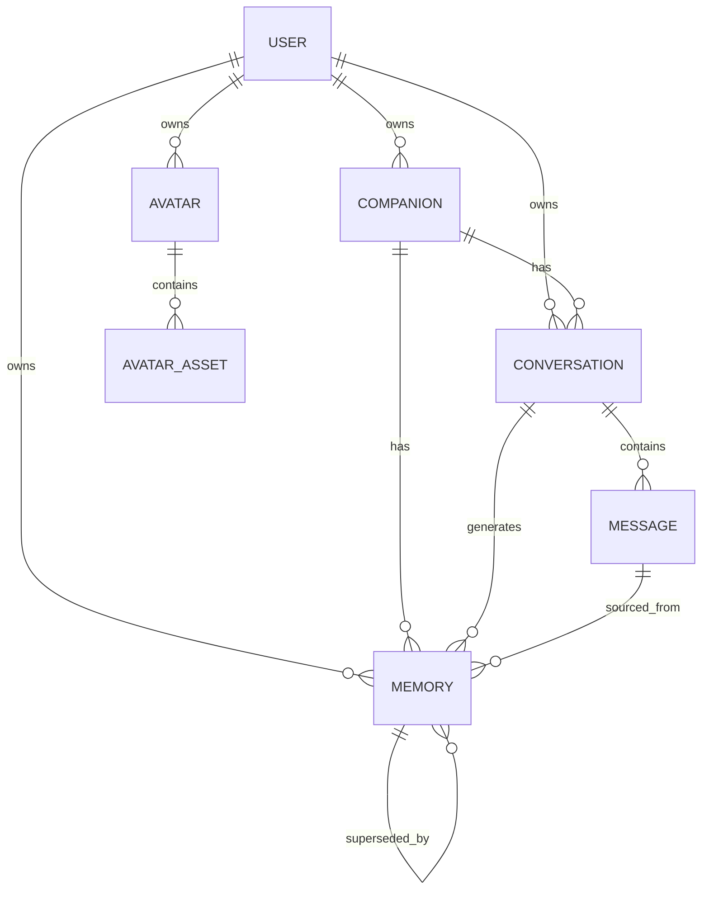
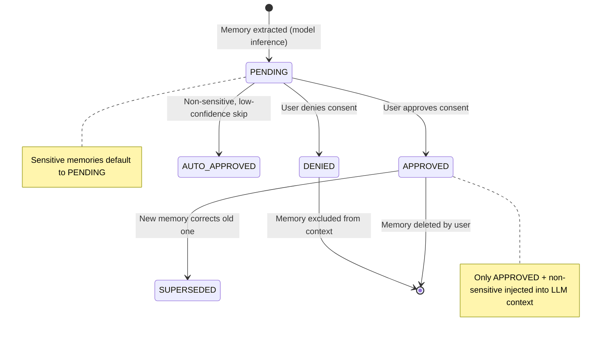
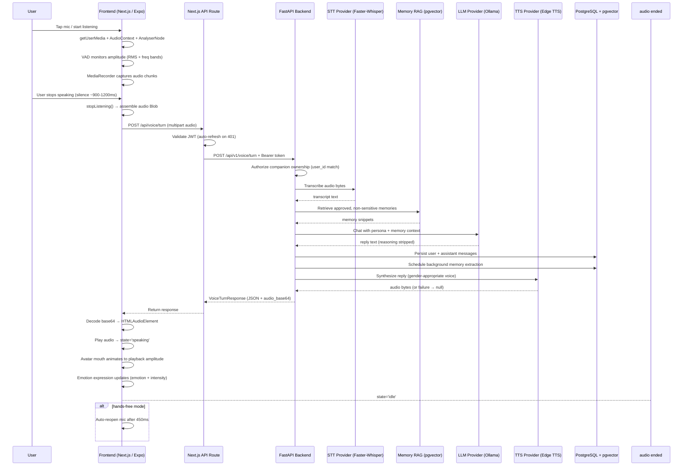
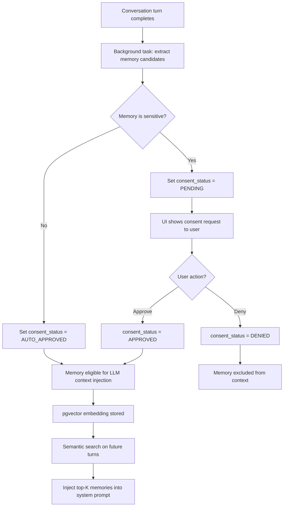
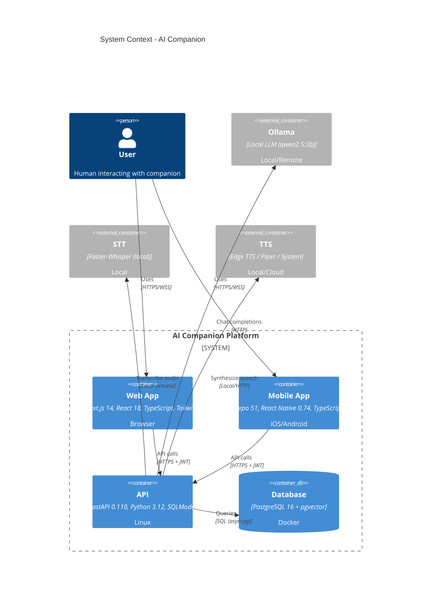

# AI Companion — Product Requirements Document (PRD)

**Document Version:** 1.0  
**Status:** Draft  
**Product:** AI Companion  
**Owner:** Product & Engineering  
**Last Updated:** November 2026

---

## 1. Executive Summary

AI Companion is a modular, privacy-first conversational AI application that lets users create, customize, and interact with persistent AI companions across web and mobile platforms. Companions support layered 2D and 3D avatars, voice-driven conversations with persistent memory, emotion-aware expressions, and user-controlled consent for sensitive memories.

The MVP delivers:
- User registration, login, and logout with JWT (RS256) authentication
- Customizable companion with layered 2D avatar and optional 3D scene
- Text-based conversations with persistent history
- Persistent memory with user controls (approve/correct/delete)
- Routine preferences saved automatically
- Sensitive memories requiring explicit user approval
- Voice conversations with local STT → RAG → LLM → TTS pipeline
- Emotion-aware avatar expressions and optional SadTalker lip-sync
- Strict data isolation between users (RLS at the database layer)

**Platforms:** Web (Next.js 14 App Router), Mobile (Expo React Native), API (FastAPI + Python 3.12)  
**Database:** PostgreSQL 16 + pgvector (via Docker)  
**Monorepo:** Turborepo with pnpm workspaces

---

## 2. Product Overview

### 2.1 Vision

Build a trusted, personal AI companion that remembers users over time, respects privacy boundaries, and feels present through voice and avatar expression — all running primarily on local infrastructure (Ollama, Edge TTS, Faster-Whisper) with optional cloud provider fallback.

### 2.2 Target Users

| Persona | Goals | Pain Points |
|---------|-------|-------------|
| **Alex, 28, busy professional** | Daily check-ins, routine reminders, emotional support | Existing chatbots don't remember context across sessions; privacy concerns with cloud-only AI |
| **Sam, 34, neurodivergent user** | Consistent companion for social practice, routine tracking | Most companions feel robotic; lacks memory of past conversations |
| **Taylor, 41, caregiver** | Companion for an elderly family member; medication/routine reminders | Complex setup; voice-first interface needed; data must stay private |

### 2.3 Core Value Propositions

1. **Persistent Memory:** Companions remember facts, preferences, events, and goals across conversations. Users can inspect, correct, and delete any memory.
2. **Privacy by Design:** Sensitive memories require explicit opt-in consent. Data is isolated per user via Row-Level Security (RLS). No data leaves local infrastructure unless the user opts into a cloud provider.
3. **Multimodal Presence:** Voice input/output with avatar lip-sync and emotion-aware expressions (2D + optional 3D).
4. **Provider Independence:** AI providers (Ollama, OpenAI, Anthropic) are behind abstract interfaces; users can self-host everything locally.

---

## 3. User Personas & Jobs-to-be-Done

### JTBD 1: Start a voice conversation
> As a user, I want to speak to my companion naturally and hear a spoken reply so I can have a hands-free conversation.

### JTBD 2: Create and customize a companion
> As a user, I want to name my companion, choose their personality and avatar appearance so the relationship feels personal.

### JTBD 3: Review and manage memories
> As a user, I want to see what my companion remembers about me, approve sensitive memories, and delete incorrect ones so I stay in control of my data.

### JTBD 4: Continue a conversation across sessions
> As a user, I want my companion to remember what we discussed last week so I don't have to repeat myself.

---

## 4. Functional Requirements

### FR-1: Authentication & User Management
| ID | Requirement | Priority |
|----|-------------|----------|
| FR-1.1 | User can register with email + password | P0 |
| FR-1.2 | User can log in and receive JWT (RS256) access token | P0 |
| FR-1.3 | User can log out; tokens are invalidated client-side | P0 |
| FR-1.4 | Passwords are hashed with Argon2id | P0 |
| FR-1.5 | All API endpoints require valid authentication | P0 |

### FR-2: Companion Management
| ID | Requirement | Priority |
|----|-------------|----------|
| FR-2.1 | User can create one or more companions (name, system prompt, personality, LLM config) | P0 |
| FR-2.2 | User can view, update, and deactivate companions | P0 |
| FR-2.3 | Companions are strictly scoped to the owning user (no cross-user access) | P0 |
| FR-2.4 | Companion gender influences default TTS voice selection | P1 |

### FR-3: Conversations (Text & Voice)
| ID | Requirement | Priority |
|----|-------------|----------|
| FR-3.1 | User can start a text conversation with a companion | P0 |
| FR-3.2 | User can send a message and receive an LLM-generated reply | P0 |
| FR-3.3 | Conversation history is persisted and retrievable | P0 |
| FR-3.4 | User can initiate a voice turn: mic → STT → LLM → TTS → playback | P0 |
| FR-3.5 | Frontend performs Voice Activity Detection (VAD) to auto-stop recording after silence | P0 |
| FR-3.6 | User can interrupt the companion mid-speech; pending responses are cancelled | P0 |
| FR-3.7 | Hands-free mode: mic auto-reopens after assistant finishes speaking | P1 |
| FR-3.8 | TTS failure is non-fatal: text reply is always returned even if audio synthesis fails | P0 |

### FR-4: Memory System
| ID | Requirement | Priority |
|----|-------------|----------|
| FR-4.1 | Assistant can extract memories from conversations (background task) | P0 |
| FR-4.2 | Memories are stored with pgvector embeddings (768-dim) for semantic search | P0 |
| FR-4.3 | Only approved, non-sensitive memories are injected into the LLM context | P0 |
| FR-4.4 | Sensitive memories default to `PENDING` consent and require user approval | P0 |
| FR-4.5 | User can list, view, update, and delete their memories | P0 |
| FR-4.6 | User can approve or deny consent for sensitive memories | P0 |
| FR-4.7 | Memories can be superseded (corrected) over time | P1 |

### FR-5: Avatar & Expression
| ID | Requirement | Priority |
|----|-------------|----------|
| FR-5.1 | Layered 2D avatar renderer with emotion-based expressions | P0 |
| FR-5.2 | Optional Three.js 3D scene with IBL/HDRI lighting and RectAreaLights | P1 |
| FR-5.3 | Avatar mouth animates to user and assistant audio amplitude | P0 |
| FR-5.4 | Emotion + intensity are derived from each turn (transcript + reply) | P0 |
| FR-5.5 | Optional SadTalker background lip-sync video generation | P2 |

### FR-6: API Surface
| ID | Requirement | Priority |
|----|-------------|----------|
| FR-6.1 | REST API documented via Swagger UI (`/docs`) and ReDoc (`/redoc`) | P0 |
| FR-6.2 | Voice turn endpoint: `POST /api/v1/voice/turn` (multipart audio) | P0 |
| FR-6.3 | Streaming TTS endpoints with word-level timestamps | P1 |
| FR-6.4 | Greeting endpoint: `POST /api/v1/voice/greeting` | P1 |

---

## 5. Non-Functional Requirements

| Category | Requirement | Target |
|----------|-------------|--------|
| **Performance** | Voice turn end-to-end latency (STT + LLM + TTS) | < 3s (local models) |
| **Performance** | Time-to-first-audio-byte | < 1.5s |
| **Reliability** | TTS failure must not break the voice turn | 100% graceful degradation |
| **Privacy** | User data isolation via RLS | Zero cross-user leaks |
| **Privacy** | Sensitive memories require explicit consent | 100% enforcement |
| **Security** | JWT signed with RS256; Argon2id password hashing | Industry standard |
| **Accessibility** | Reduced-motion support (prefers-reduced-motion) | WCAG AA |
| **Compatibility** | Chrome, Firefox, Safari (desktop + mobile) | Latest 2 versions |
| **Observability** | Structured logging; OpenTelemetry ready | — |

---

## 6. Data Model

### 6.1 Entity Relationship Diagram



### 6.2 Core Entities

| Entity | Key Fields | Description |
|--------|-----------|-------------|
| `users` | id, email (CITEXT, unique), password_hash, email_verified, is_active, deleted_at | Authenticated users |
| `companions` | id, user_id, name, system_prompt, personality (JSON), llm_config (JSON), is_active | AI companion definitions |
| `conversations` | id, user_id, companion_id, title, summary, message_count, last_message_at, deleted_at | Conversation threads |
| `messages` | id, conversation_id, role (user/assistant/system/tool), content, token_count, metadata (JSON), created_at | Individual messages |
| `memories` | id, user_id, companion_id, content, memory_type, category, source, confidence, is_sensitive, consent_status, embedding (Vector 768), source_message_id, superseded_by | Persistent user memories |
| `avatars` | id, user_id, name, config_version, config (JSON), preview_url, is_active | Avatar configurations |
| `avatar_assets` | id, layer_type, variant, asset_url, metadata (JSON) | Avatar layer assets |
| `audit_logs` | id, user_id, action, resource_type, resource_id, ip_address, user_agent, metadata | Security audit trail |

### 6.3 Memory Lifecycle



---

## 7. API Specification

Base URL: `http://localhost:8000`  
Auth: `Authorization: Bearer <JWT>`  
Docs: `GET /docs` (Swagger), `GET /redoc` (ReDoc)

### 7.1 Authentication (`/api/v1/auth/*`)

| Method | Endpoint | Description | Body |
|--------|----------|-------------|------|
| POST | `/register` | Register new user | `{email, password, full_name?}` |
| POST | `/login` | Authenticate, return JWT | `{email, password}` |
| POST | `/logout` | Invalidate session | — |
| GET | `/me` | Current user profile | — |

### 7.2 Companions (`/api/v1/companions/*`)

| Method | Endpoint | Description |
|--------|----------|-------------|
| GET | `` | List user's companions (paginated) |
| POST | `` | Create companion |
| GET | `/{id}` | Get companion detail |
| PUT | `/{id}` | Update companion |
| DELETE | `/{id}` | Deactivate companion |

### 7.3 Conversations (`/api/v1/conversations/*`)

| Method | Endpoint | Description |
|--------|----------|-------------|
| GET | `` | List conversations |
| POST | `` | Create conversation |
| GET | `/{id}` | Get conversation + messages |
| POST | `/{id}/messages` | Send text message |
| DELETE | `/{id}` | Soft-delete conversation |

### 7.4 Voice (`/api/v1/voice/*`)

| Method | Endpoint | Description |
|--------|----------|-------------|
| POST | `/turn` | Full voice turn (multipart: audio_file, companion_id, conversation_id?, text?, voice?) |
| POST | `/greeting` | Companion opening greeting |
| POST | `/synthesize` | TTS synthesis |
| POST | `/synthesize-stream` | Streaming TTS |
| POST | `/synthesize-stream-with-timestamps` | Streaming TTS + word alignment |

### 7.5 Memory (`/api/v1/memories/*`)

| Method | Endpoint | Description |
|--------|----------|-------------|
| GET | `` | List memories (with filters) |
| GET | `/{id}` | Get memory detail |
| PUT | `/{id}` | Update memory content |
| DELETE | `/{id}` | Delete memory |
| POST | `/{id}/consent` | Approve/deny consent |
| POST | `/extract` | Trigger memory extraction from conversation |

### 7.6 Voice Turn Response Schema

```json
{
  "conversation_id": "uuid",
  "user_message_id": "uuid",
  "assistant_message_id": "uuid",
  "transcript": "user's spoken words",
  "reply_text": "companion's spoken reply",
  "companion_id": "uuid",
  "companion_name": "Aria",
  "audio_base64": "base64 MP3/WAV or null",
  "audio_format": "audio/mpeg",
  "tts_provider": "edge-tts",
  "model": "qwen2.5:3b",
  "emotion": "happy",
  "emotion_intensity": 0.5,
  "sadtalker_job_id": null
}
```

---

## 8. End-to-End Flowcharts

### 8.1 Voice Conversation Flow (End-to-End)



### 8.2 Memory Extraction & Consent Flow



### 8.3 Avatar Expression Flow

```mermaid
flowchart TD
    A[Voice turn: transcript + reply] --> B[analyze_conversational_emotion()]
    B --> C[emotion + intensity (0.0-1.0)]
    C --> D[2D Avatar: expression update]
    C --> E[3D Scene: material/lighting mood shift]
    A --> F[Audio playback amplitude]
    F --> G[AnalyserNode RMS per frame]
    G --> H[Avatar mouth open/close animation]
    D --> I[Render frame]
    E --> I
    H --> I
```

### 8.4 Architecture Diagram



---

## 9. Frontend Architecture

### 9.1 Web (`apps/web`)

**Stack:** Next.js 14 (App Router), React 18, TypeScript, Tailwind CSS, `@react-three/fiber`, `@react-three/drei`

**Key directories:**
```
src/
├── app/                 # App Router pages & API routes
│   ├── api/voice/turn/route.ts   # Next.js proxy to FastAPI voice turn
│   ├── api/voice/greeting/route.ts
│   ├── api/auth/...
│   ├── api/conversations/...
│   ├── api/memories/...
│   └── layout.tsx, page.tsx
├── components/
│   ├── companion/
│   │   ├── AvatarRenderer.tsx        # 2D avatar + emotion expressions
│   │   ├── FullBodyAvatar.tsx        # 3D/2D toggle container
│   │   ├── VoiceSettingsModal.tsx    # Voice config UI
│   │   └── 3d/
│   │       ├── EnhancedAvatarScene.tsx   # Three.js canvas scene
│   │       ├── EnhancedAvatarModel.tsx   # GLTF model + PBR materials
│   │       ├── EnhancedStudioEnvironment.tsx  # IBL + RectAreaLights
│   │       └── RectAreaLight.tsx
│   │   └── video/VideoAvatarRenderer.tsx  # SadTalker video playback
│   └── ...
├── hooks/
│   └── useLiveVoiceCompanion.ts   # Mic capture, VAD, playback, interruption
├── context/                  # React context (auth, companion)
└── lib/                      # Utilities (api client, voice manager, emotion)
```

**Key hook — `useLiveVoiceCompanion`:**
- `startListening()` — mic permission, AudioContext, MediaRecorder, Web Speech API
- `monitorAudioLevels()` — RMS + frequency-band VAD, silence detection (~900-1200ms)
- `submitVoiceTurn()` — multipart upload to Next.js proxy
- `playAssistantAudio()` — base64 decode → HTMLAudioElement → mouth animation
- `interrupt()` — cancel fetch, stop playback, abort SadTalker job

### 9.2 Mobile (`apps/mobile`)

**Stack:** Expo 51, React Native 0.74, TypeScript, NativeWind, `expo-av`

**Key screens:** `app/(tabs)/chat.tsx` — full voice companion stage with:
- Photorealistic 2D avatar rendering
- Streaming TTS with word-level timestamps for viseme animation
- Push-to-talk and text fallback
- Interruption handling
- GPU disposal on unmount

---

## 10. Backend Architecture

### 10.1 API (`apps/api`)

**Stack:** FastAPI 0.110, Python 3.12, SQLModel, SQLAlchemy (async), Alembic migrations

**Directory structure:**
```
src/app/
├── main.py              # FastAPI app factory, middleware, exception handlers
├── core/
│   ├── config.py        # Pydantic Settings (env vars)
│   ├── database.py      # Async engine, session factory
│   ├── security.py      # JWT (RS256), Argon2id, key generation
│   └── exceptions.py    # Custom exception classes
├── api/v1/
│   ├── router.py        # Route aggregation
│   └── endpoints/
│       ├── auth.py
│       ├── companion.py
│       ├── conversation.py
│       ├── voice.py
│       ├── memory.py
│       ├── avatar.py
│       ├── health.py
│       └── sadtalker.py
├── models/              # SQLModel tables (user.py contains all tables)
├── schemas/             # Pydantic request/response schemas
├── services/
│   ├── voice.py         # VoiceService.execute_voice_turn (STT→RAG→LLM→TTS)
│   ├── conversation.py  # ConversationService (chat, memory RAG, persistence)
│   ├── memory.py        # Memory CRUD + consent
│   ├── extraction.py    # Background memory extraction
│   ├── emotion.py       # analyze_conversational_emotion()
│   ├── sensitivity.py   # Sensitive memory detection
│   └── sadtalker.py     # SadTalker lip-sync job submission
├── providers/
│   ├── factory.py       # Provider selection (Ollama/OpenAI/Anthropic)
│   ├── ollama_provider.py
│   ├── openai_provider.py
│   ├── anthropic_provider.py
│   ├── stt.py           # Faster-Whisper + Mock
│   └── tts.py           # Edge TTS + Piper + System TTS
└── repositories/        # Data access layer (planned)
```

### 10.2 Voice Service Pipeline (`VoiceService.execute_voice_turn`)

1. **Authorize** — companion belongs to `user_id`, `is_active = true`
2. **Resolve transcript** — client text or local STT (Faster-Whisper)
3. **Conversation** — resolve existing or create new (`"Voice with <name>"`)
4. **AI response** — `ConversationService.chat(voice_mode=True)`:
   - Memory RAG: pgvector similarity search over approved, non-sensitive memories
   - Companion persona system prompt injection
   - Ollama LLM call (`qwen2.5:3b`)
   - Strip internal `\` reasoning tags
   - Atomic persist user + assistant messages
   - Background memory extraction
5. **TTS** — gender-appropriate voice (Edge TTS / Piper / System); non-fatal
6. **Emotion** — `analyze_conversational_emotion(transcript, reply)`
7. **SadTalker** — optional background lip-sync job (non-blocking)

---

## 11. Privacy & Security

### 11.1 Data Isolation
- All user-scoped tables have `user_id` foreign key
- Row-Level Security (RLS) policies enforce `user_id = auth.uid()` at the database layer
- API layer also filters by `user_id` in every query (defense in depth)

### 11.2 Consent Model
- `consent_status`: `PENDING` | `APPROVED` | `DENIED` | `AUTO_APPROVED`
- `is_sensitive` flag marks memories requiring explicit consent
- Only `APPROVED` + non-sensitive memories are injected into LLM context
- Users can inspect, correct, and delete any memory at any time

### 11.3 Authentication
- RS256 JWT signing (public/private key pair generated at setup)
- Argon2id password hashing
- Access tokens stored client-side; refresh on 401 via Next.js proxy

### 11.4 Audit
- `audit_logs` table records actions, resource types, IP addresses, user agents
- All data mutations are auditable

---

## 12. Configuration & Environment

Key environment variables (see `.env.example`):

| Variable | Description | Required |
|----------|-------------|----------|
| `DATABASE_URL` | PostgreSQL connection string | Yes |
| `JWT_SECRET_KEY` | JWT signing secret (or RS256 keys) | Yes |
| `OPENAI_API_KEY` | OpenAI API key | One of |
| `ANTHROPIC_API_KEY` | Anthropic API key | One of |
| `OLLAMA_BASE_URL` | Local Ollama endpoint | One of |
| `SADTALKER_ENABLED` | Enable lip-sync video generation | No (default false) |
| `EMBEDDING_DIMENSION` | Vector dimension for pgvector | No (default 768) |

---

## 13. Release Roadmap

| Milestone | Scope | Target |
|-----------|-------|--------|
| **MVP (v0.1)** | Auth, companions, text conversations, basic memory, 2D avatar | Complete |
| **Voice MVP (v0.2)** | STT → LLM → TTS voice turns, VAD, interruption, emotion | Complete |
| **Privacy Hardening (v0.3)** | Consent UI for sensitive memories, memory inspection/correction, RLS | In Progress |
| **3D Avatar (v0.4)** | Three.js scene, IBL/HDRI, RectAreaLights, 3D/2D toggle | In Progress |
| **Mobile (v0.5)** | Expo app, push-to-talk, streaming TTS with visemes | In Progress |
| **SadTalker (v0.6)** | Background lip-sync video generation | Planned |
| **Cloud Providers (v0.7)** | OpenAI/Anthropic fallback, provider selection UI | Planned |

---

## 14. Success Metrics

| Metric | Target |
|--------|--------|
| Voice turn latency (end-to-end) | < 3s |
| TTS failure rate | < 5% (graceful degradation) |
| Memory consent approval rate | > 70% |
| Cross-user data leaks | 0 |
| Monthly active conversations per user | > 5 |
| Memory correction rate | < 10% |

---

## 15. Open Questions

1. **SadTalker dependency:** Requires GPU and significant model download. Should be optional behind a feature flag.
2. **Mobile push notifications:** Not yet implemented; needed for companion-initiated check-ins.
3. **Multi-language support:** STT/TTS currently English-focused; language detection is basic.
4. **Offline mode:** Local-first architecture supports it, but frontend offline caching is not yet built.

---

## 16. Appendix: Key Files

| File | Purpose |
|------|---------|
| `apps/api/src/app/services/voice.py` | Backend voice orchestration |
| `apps/api/src/app/models/user.py` | All SQLModel tables (User, Companion, Conversation, Message, Memory, Avatar, AuditLog) |
| `apps/api/src/app/schemas/voice.py` | Voice request/response Pydantic schemas |
| `apps/web/src/hooks/useLiveVoiceCompanion.ts` | Frontend voice capture, VAD, playback, interruption |
| `apps/web/src/app/api/voice/turn/route.ts` | Next.js proxy to FastAPI voice turn |
| `apps/mobile/app/(tabs)/chat.tsx` | Mobile voice companion screen |
| `packages/shared/src/index.ts` | Shared TypeScript types (planned) |
| `logics.md` | Detailed voice flow logic |
| `.env.example` | Environment variable template |
